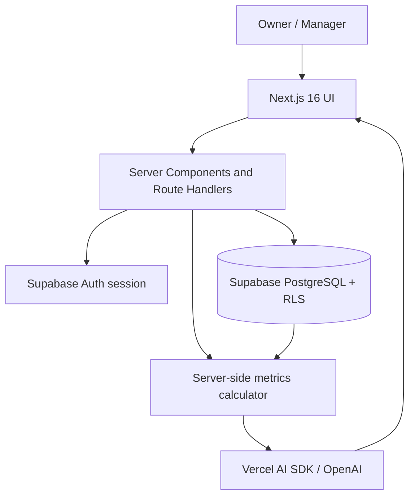

# BarberPro AI Insights — Architecture Notes

## Assignment scope
This is the **Week 4 Graded Assignment 4.2** mini-project, not the full commercial BarberPro AI SaaS. The brief requires a usable AI web application, a live URL, public GitHub repository, GitHub Actions, no committed secrets, and documentation. It recommends Next.js 14, Tailwind, Supabase, Vercel AI SDK, and Vercel. These tools are recommendations, not mandatory. This project uses **Next.js 16** instead of 14 after a dependency security review (see spec.md §11, decision 7).

## Technical decisions
- **UI:** Next.js 16 App Router (React 19), TypeScript (strict), Tailwind CSS, optional shadcn/ui, Recharts.
- **Server:** Next.js Route Handlers for validated mutations and AI requests; Server Components for initial reads. No separate FastAPI service in the MVP.
- **Data:** Supabase PostgreSQL; Supabase Auth; **Row Level Security (RLS)** on every tenant-owned table.
- **AI:** Vercel AI SDK with OpenAI through a server-only route; summarize computed metrics and give evidence-backed suggestions. Never grant an LLM database credentials or raw SQL execution.
- **Deployment:** GitHub -> GitHub Actions (checks) -> Vercel (deployment), with Supabase hosted separately. Production deploy only after tests pass (and environment protection, if available).

## Logical flow

## Multi-tenant model
A tenant is one barbershop business. Each `barbershops` record is owned by an authenticated user, and the minimum viable role is `owner`; `manager` is optional for the assignment. Each `barbers`, `services`, and `sales` row has `barbershop_id`. Queries must check membership and RLS. Never trust a barbershop ID sent by the client as evidence of access; on every read or mutation, validate the authenticated user and authorized membership. Do not use a Supabase service-role key in browser code or normal user request paths.

## Data model (initial)
- `barbershops(id uuid pk, name text, created_at timestamptz)`
- `memberships(user_id uuid, barbershop_id uuid, role text, primary key (user_id,barbershop_id))`
- `barbers(id uuid pk, barbershop_id uuid fk, name text, active boolean, commission_rate numeric(5,4))`
- `services(id uuid pk, barbershop_id uuid fk, name text, price numeric(12,2), active boolean)`
- `sales(id uuid pk, barbershop_id uuid fk, barber_id uuid fk, service_id uuid fk, quantity int, unit_price numeric(12,2), gross_total numeric(12,2), commission_rate numeric(5,4), commission_amount numeric(12,2), payment_method text, occurred_at timestamptz, created_by uuid fk, request_key uuid)`
- Add unique `(barbershop_id, request_key)` to prevent accidental duplicate checkout submissions; use a transaction or a server-side Postgres RPC to record validated snapshots atomically.

Use **snapshots** of `unit_price` and `commission_rate` in `sales` so historical reports remain accurate when settings change. Monetary values use exact PostgreSQL `numeric`, not JS floating-point math as a source of truth. Store and calculate with integer centavos in TypeScript or a tested decimal library, then convert deliberately at the database boundary. Report dates use `Asia/Manila` and a documented date range.

## Endpoints
- `GET /api/health` — anonymous basic status without credentials or internal diagnostics.
- `POST /api/sales` — authenticated sale; validates input, barber/service tenancy, snapshots prices, calculates commission, idempotent insert.
- `GET /api/metrics?from=YYYY-MM-DD&to=YYYY-MM-DD` — authenticated summary for authorized barbershop, with explicit timezone.
- `POST /api/ai/insights` — authenticated, rate-limited request; compute metrics server-side; call OpenAI with aggregates; return structured insights including supporting numbers.

## AI safety and data flow
1. Confirm authenticated identity and business membership.
2. Fetch the business's aggregated data through authorized server-side queries.
3. Validate a minimum data threshold; otherwise return a clear insufficient-data message.
4. Send only necessary non-identifying aggregates to the model, not customer contact details, credentials, or other tenants' records.
5. Ask the model for 3 data-grounded insights with evidence, limits, and suggested action; parse and validate structured output.
6. Clearly label AI recommendations; do not claim forecasts are guaranteed, and never invent numerical results.
7. Implement timeouts, controlled retries, cost limits, and rate limiting; store no raw user secrets in logs.

## Quality gates
Unit tests cover commission rounding, aggregated daily totals, and AI insight schema/insufficient-data behavior; integration tests verify authentication and cross-tenant rejection. CI runs `npm ci`, `npm run lint`, `npm run typecheck`, `npm test`, and `npm run build`. Use mocked AI responses in CI. The assignment requires at least three unit tests.

## Operational boundaries
No real payment processing, actual tax invoicing, payroll payouts, hairstyle generation, subscription billing, or unrestricted generative chatbot for the MVP. Cash/GCash selections are **records of an externally completed payment**, not integrations.
